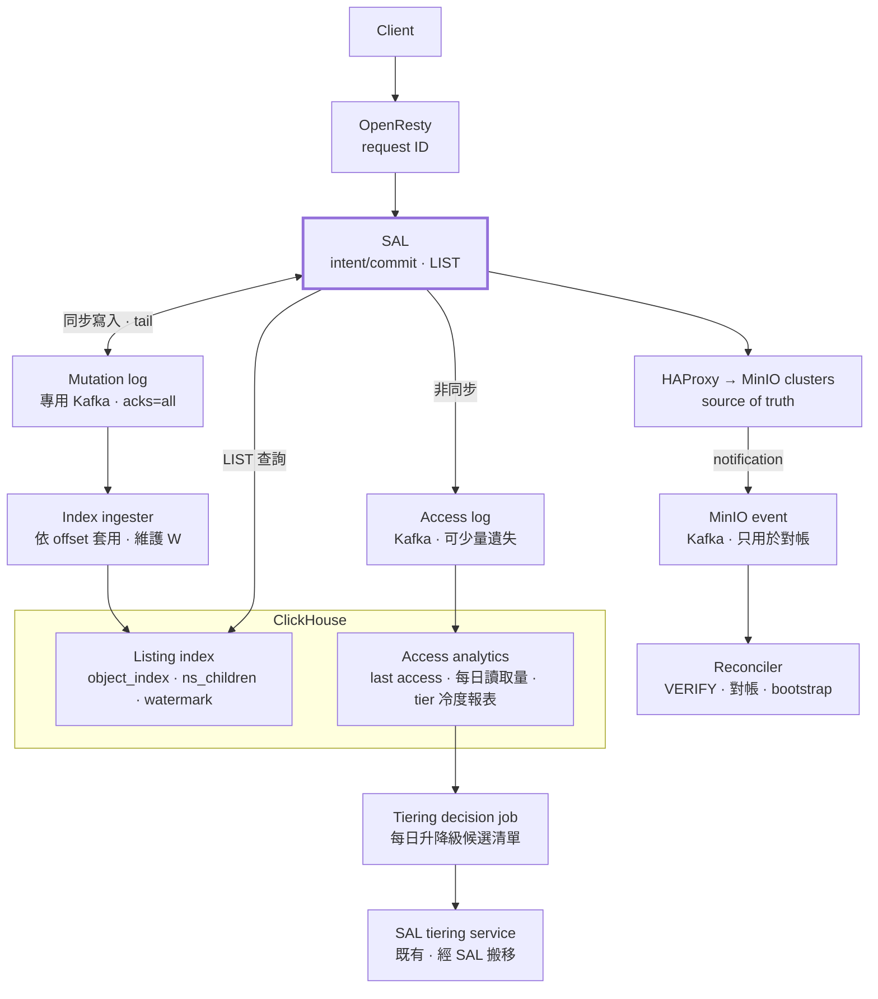
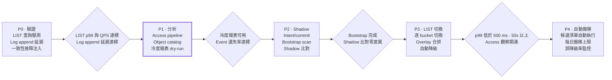

# SAL Metadata Index & Access Analytics 系統架構設計 (Rev A)

2026-11-11 · Jason Lin

## 1. 摘要與關鍵決策

Strong consistency 不由 index DB 提供，而由 SAL 寫入路徑上的同步 mutation log，加上 LIST 時的 overlay 合併提供。ClickHouse 因此只需要是 log 的非同步 materialized view，可以沿用 ClickHouse + Kafka，不必引入 TiKV 類的 strongly consistent KV。

新需求帶來的唯一硬性代價：mutation log 成為寫入路徑上的同步依賴。每個 PUT/DELETE 多一次 `acks=all` 的 Kafka append，log 不可用時寫入必須失敗或 bucket 降級。

| # | 決策 | 理由 | 代價 |
| --- | --- | --- | --- |
| D1 | SAL 是唯一的 mutation 入口，每個 mutation 走 INTENT → MinIO → COMMIT | 解決 MinIO 與 index 的 dual-write；SAL crash 後能從 intent 找回狀態不確定的 key | 寫入延遲增加一次同步 log append；log 成為 Tier-0 依賴 |
| D2 | LIST = ClickHouse snapshot（到 watermark W）+ SAL 記憶體 overlay（W 之後的 mutation） | Read-after-write 與 index 的 ingest lag 脫鉤 | 每個 SAL node 要 tail mutation log；LIST 前多一次 offset 同步 |
| D3 | 狀態不確定的 key 一律以 HEAD 向 MinIO 求證 | MinIO 是唯一的 source of truth，index 永遠不猜 | 併發寫同一 key 時 LIST 多幾次 HEAD |
| D4 | GET/HEAD/PUT/DELETE 直達 MinIO，index 不在 single-object 路徑上 | MinIO 單一 object 操作已是 strict consistency；index 故障不影響資料面 | Index 只加速 LIST |
| D5 | Access event 走獨立、非同步的 pipeline | 讀取量遠大於寫入量，不能拖慢 GET | Last-access 是近似值，policy 要留安全邊際 |
| D6 | Index 有任何異常，該 bucket 自動退回 MinIO 原生 listing | 寧可慢，不可錯 | 降級期間 listing 回到秒級 |
| D7 | 先交付 access 分析，再改寫入路徑 | 核心目標不需要 strong consistency，可以最早上線 | Listing 加速排在第二階段之後 |

## 2. 需求、範圍與假設

系統收集兩類事件，服務兩個用途，並對 LIST 提供與 MinIO 原生相同的 consistency。

| 編號 | 需求 | 驗收標準 |
| --- | --- | --- |
| R1 | 收集所有 MinIO cluster 的 metadata 變更 | 經 SAL 的 mutation 零遺失；繞過 SAL 的變更在分鐘級內被偵測並修復 |
| R2 | 收集所有經過 gateway 的存取事件 | 遺失率可量測，目標 < 0.1% |
| R3 | Object 層級 access 分析，驅動 hot ↔ warm ↔ cold tiering（核心目標） | 可回答「hot tier 上有多少 bytes 已 90 天未讀」；每日產出升降級候選清單 |
| R4 | S3 listing 加速 | 單頁 p99 < 500 ms；冷大 prefix 比 MinIO 原生快 ≥ 50x |
| R5 | Listing 與所有 S3 command 具 strong read-after-write consistency | 寫入回 200 後，任何 SAL node 的下一個 LIST 必定反映該寫入 |
| R6 | 規模 | 5B objects、LOSF、多個 MinIO cluster |

**不在範圍內**

- Tiering 的實際搬移。本系統只產出決策，搬移由既有的 SAL tiering service 執行。
- GET/HEAD 的加速或 location lookup。Index 不進入 single-object 路徑。
- `ListObjectVersions`、`ListMultipartUploads`、`ListParts` 的加速。第一版一律 passthrough 到 MinIO，consistency 由 MinIO 保證。

**設計假設**

下列數字是為了讓 sizing 能往下算而設的假設，不是實測值。Phase 0 量到真實數字後要回頭校正第 10 節。

| 項目 | 假設值 | 影響 |
| --- | --- | --- |
| 寫入 QPS（PUT + DELETE） | 平均 1,000/s，peak 5,000/s | Mutation log 流量、寫入延遲預算 |
| 讀取 QPS（GET + HEAD） | 平均 5,000/s，peak 20,000/s | Access topic 流量、raw log 儲存量 |
| LIST QPS | Peak 500/s，其中 70% 帶 `delimiter=/` | ClickHouse 查詢併發 |
| Key | 平均 100 bytes，目錄深度 6 層 | Index 大小、`ns_children` 的 row 數 |
| Bucket | 200 個，最大單一 bucket 1B objects | Partition 與 shard 策略 |
| Object 總數 | 穩定在 5B 左右，新增與到期刪除大致平衡 | Index 容量預留 |
| 每日被讀到的 distinct object | 50M，約佔總數 1% | `object_access_daily` 的大小 |
| Bucket versioning | 未啟用 | Index 不含版本維度 |

## 3. 整體架構

系統在既有資料面之外加上三個 plane：寫入路徑上同步的 consistency plane，以及非同步的 index plane 與 analytics plane。Object bytes 的路徑完全不變。



*圖：系統架構。寫入同步記進 mutation log，index 與分析都走非同步路徑。SAL 是唯一的 mutation 入口，也是主要改動點。*

SAL 往下的三條線分別是 mutation log、LIST 查詢與 access event。只有第一條在寫入回應之前同步完成。

| 元件 | 職責 | 狀態 |
| --- | --- | --- |
| OpenResty | Rate limiting；產生 request ID 並往下傳 | 既有，小改 |
| SAL | Mutation 的 intent/commit、access event 發送、log tailer、LIST 服務（index + overlay 合併） | 既有，主要改動點 |
| HAProxy → MinIO clusters | Object 資料與 single-object 操作的 source of truth | 既有，不改 |
| Mutation log（Kafka，專用 cluster） | 有序、durable 的 mutation 記錄，是 consistency 的基礎 | 新增 |
| Access log（Kafka） | 高流量、可容忍少量遺失的 access event | 新增 |
| MinIO bucket notification → Kafka | 偵測繞過 SAL 的變更，只用於對帳 | 新增 |
| Index ingester | 依 log 順序把 mutation 寫進 ClickHouse，維護 watermark | 新增 |
| ClickHouse | Listing index、access 聚合、tiering 分析 | 新增 |
| Reconciler | 解決 dangling intent、持續對帳、bootstrap scan | 新增 |
| Tiering decision job | 每日產出升降級候選，交給 SAL tiering service | 新增 |
| etcd | 每個 bucket 的 index 狀態 | 既有（SAL config store） |

三條資料流：

1. **寫入**：SAL 把 INTENT 寫進 mutation log，執行 MinIO 操作，再寫 COMMIT，然後回應 client。Ingester 非同步把 COMMIT 套用到 ClickHouse。
2. **LIST**：SAL 取得 log 最新 offset，等本機 tailer 追上，查 ClickHouse，合併 overlay，對 pending key 做 HEAD，然後回應。
3. **讀取**：GET/HEAD 直達 MinIO。回應結束後 SAL 非同步送出 access event，經 Kafka 進 ClickHouse 聚合，供 tiering decision job 使用。

## 4. 一致性設計

寫入在回應 client 之前一定已經在 mutation log 裡，LIST 在回答之前一定已經讀到 log 的最新位置。這兩條合起來就是 read-after-write，與 ClickHouse 落後多少無關。

### 4.1 為什麼不能只靠 MinIO event 或非同步 ingest

- MinIO bucket notification 是非同步的。寫入回 200 時 event 可能還沒送出，target 不可用時也可能遺失。
- 「先寫 MinIO，再寫 index」的做法，在兩步之間 crash 就會留下 index 不知道的 object。GET 看得到、LIST 看不到，直接違反 R5。

### 4.2 寫入協定

1. SAL 產生 `op_id`，以 `acks=all` 把 `INTENT{op_id, bucket, key, op, sal_node}` 寫進 mutation log。失敗就回 503，不碰 MinIO。
2. SAL 對 MinIO 執行操作。
3. SAL 把 `COMMIT{op_id, etag, size, mtime, version_id}` 或 `ABORT{op_id}` 寫進 log。
4. 回應 client。

只有步驟 1 是正確性必需的。SAL 若在步驟 2 與 3 之間 crash，log 裡會留下沒有結果的 intent，該 key 進入 pending 狀態，由 reconciler 求證。

適用的操作：`PutObject`、`CopyObject`（目的端）、`CompleteMultipartUpload`、`DeleteObject`、`DeleteObjects`（一筆 intent 帶所有 key），以及 tiering 搬移的 `RELOCATE`。

### 4.3 Key 的兩種狀態

SAL tailer 與 ingester 都從同一份 log 推導，結論必然相同。

- **clean**：該 key 的 intent 全部已結束，且各 intent 的 [INTENT, COMMIT] 區間互不重疊。Key 的狀態就是 log 順序上最後一筆 COMMIT。
- **pending**：有尚未結束的 intent，或有兩個 intent 的區間重疊。

重疊必須視為 pending，因為兩個併發操作打同一個 key 時，MinIO 的套用順序不一定等於 COMMIT 進 log 的順序。例如 PUT 與 DELETE 併發，MinIO 先刪後寫，object 存在；但 log 裡 DELETE 的 COMMIT 較晚，index 會誤判為已刪除。區間不重疊時，log 順序必然等於 MinIO 的套用順序。

Pending key 由 reconciler 解決：寫 `INTENT{op=VERIFY}`，對 MinIO 做 HEAD，把觀察到的狀態寫成 COMMIT。VERIFY 遵守同一條重疊規則，所以 key 安靜下來後一定收斂。Reconciler 的觸發條件是 intent 超過 timeout，或 `sal_node` 的 etcd lease 失效。

### 4.4 LIST 讀取協定

1. 取得該 bucket 所屬 partition 的 high watermark `E`。同一時間進來的 LIST 共用一次 Kafka `ListOffsets` 呼叫。
2. 等本機 tailer 消費到 `E`。
3. 先讀目標 ClickHouse replica 的 applied watermark `W`，再向同一個 replica 查詢該頁。順序不可顛倒。
4. 用 overlay 中 offset > `W` 的 mutation 覆蓋查詢結果，包含新增、覆寫與刪除。合併後不足 `max-keys` 就往後續查。
5. 對頁面範圍內的 pending key 做 HEAD，以 MinIO 的回應為準。
6. 回應 client。

正確性論證：寫入回 200 時，它的 INTENT offset 必然小於之後任何 LIST 取得的 `E`。該 key 只有三種可能：已經在 index 裡（offset ≤ `W`）、在 overlay 裡是 clean、或是 pending 並由 HEAD 求證。三種情況 LIST 都反映該寫入。

### 4.5 SAL 必須是唯一的 writer

- MinIO credentials 只發給 SAL 與 reconciler，network policy 擋掉直連。
- 已啟用 index 的 bucket 關閉 MinIO 原生 ILM expiration 與 transition。到期刪除與搬移都改為經過 SAL 執行。
- 繞過 SAL 的變更靠第 8 節的對帳偵測，屬於事後修復，不在 R5 的保證範圍內。

### 4.6 Overlay 的界限

Overlay 只保留 offset 大於所有 replica 最小 `W` 的 mutation，大小約等於「寫入 QPS × ingest lag」。以第 2 節的假設，ingest lag 2 秒時約 10,000 個 key。Lag 超過 30 秒或 overlay 超過 200,000 個 key 時，該 bucket 轉為 DEGRADED，LIST 退回 MinIO 原生路徑。SAL 重啟後要先從最小 `W` 重播到 `E`，才開始用 index 回答 LIST。

## 5. 資料收集

三個事件來源的可靠度要求不同，所以分成三個 topic，其中 mutation log 放在獨立的 Kafka cluster。寫入路徑的延遲與可用性不能被 access 流量或分析 consumer 拖累。

| 來源 | Topic | 內容 | Delivery | Partition key | 用途 |
| --- | --- | --- | --- | --- | --- |
| SAL 寫入路徑 | `sal.mutation.v1` | INTENT、COMMIT、ABORT | 同步；`acks=all`、RF=3、`min.insync.replicas=2`、關閉 unclean leader election、idempotent producer | bucket | Listing index、object catalog |
| SAL 回應後 hook | `sal.access.v1` | 每個 request 一筆 | 非同步；`acks=1`、批次、本機磁碟 spool | hash(bucket, key) | Access 分析、audit |
| MinIO bucket notification | `minio.event.v1` | ObjectCreated、ObjectRemoved | MinIO Kafka target 加 `queue_dir` | 由 MinIO 決定 | 只用於對帳，偵測 bypass |

### 5.1 Mutation log

Partition key 用 bucket，讓每個 bucket 只有一個 watermark，LIST 只需同步一個 partition。超大 bucket 可以拆成多個 sub-partition，LIST 改用 vector watermark。

Index 內的版本號 `seq` = (partition epoch, COMMIT offset)。Bucket 換 partition 時 epoch 加一，確保 `seq` 單調遞增。

COMMIT 除了 4.2 的欄位，還帶 `cluster` 與 `tier`，讓 index 同時是跨 cluster 的 object catalog。

### 5.2 Access event

| 欄位 | 說明 |
| --- | --- |
| `ts`、`request_id`、`sal_node` | `request_id` 由 OpenResty 產生並往下傳 |
| `cluster`、`bucket`、`key`、`version_id`、`tier` | 實際服務該 request 的位置 |
| `op`、`status` | S3 API 名稱與 HTTP status |
| `bytes_sent`、`bytes_received`、`is_range` | 讀寫量 |
| `latency_ms`、`ttfb_ms` | 供效能分析 |
| `principal`、`client_ip`、`user_agent` | 供 audit |
| `actor_class` | `user`、`tiering`、`reconciler`、`backup`、`replication` |

兩條規則決定 last-access 的品質：

- **排除系統自己的讀取。** Mover、reconciler 的 HEAD、備份都要標上 `actor_class`，並排除在 last-access 之外。否則搬移和對帳本身會讓所有 object 看起來都是熱的。
- **明確定義什麼算「讀」。** `GetObject`（含 range）、`CopyObject` 的來源端、`SelectObjectContent` 算讀取。`HeadObject` 與 LIST 預設不算，可依 bucket 設定。

發送方式：SAL 在 response 完成後把 event 放進 bounded queue，背景 producer 批次送出。Kafka 不可用時寫到本機磁碟 spool，恢復後補送。Queue 與 spool 都滿才丟棄，並累計到 `access_events_dropped_total`。

在 OpenResty 就被擋下的 request（例如 429）不會到達 SAL，也與 tiering 無關，維持既有的 OpenResty access log 即可。

## 6. Metadata Index 與 Listing 服務

Index 是兩張 ClickHouse table：一張依完整 key 排序，服務 flat listing；一張依 (parent, name) 排序，服務 delimiter listing。兩張都是 mutation log 的 deterministic materialization。

### 6.1 Table 設計

| Table | Engine | ORDER BY | 服務對象 |
| --- | --- | --- | --- |
| `object_index` | ReplacingMergeTree(seq, is_deleted) | (bucket, key) | 無 delimiter 的 LIST、object catalog、tiering 分析 |
| `ns_children` | AggregatingMergeTree | (bucket, parent, name) | `delimiter=/` 的 LIST、prefix 層級的 object 數與 bytes |
| `ingest_watermark` | ReplacingMergeTree | (partition) | 該 replica 已套用到的 offset `W` |

需要兩種排序，因為 (parent, name) 的順序不等於 key 的字典序。以 `a/b` 和 `a0` 為例，key 字典序是 `a/b` 在前，(parent, name) 順序則是 `a0` 在前。

`ns_children` 的寫法：每個 object 在自己的 parent 下有一筆帶 metadata 的 leaf row，並對每一層祖先目錄貢獻一筆 delta。建立是 +1，刪除是 −1，覆寫是 0。目錄存在的條件是 `sum(child_count) > 0`。

這樣 delimiter LIST 就是對 (bucket, parent) 的一次 range scan，`CommonPrefixes` 與 `Contents` 一起取回，不需要逐個目錄 skip-scan。附帶的好處是任何 prefix 的 object 數與 bytes 可以即時查到。

Delta 需要知道 key 的前一個狀態。Ingester 套用每個 batch 之前，先向同一個 replica 的 `object_index` 查出 batch 內所有 key 的現況。每個 partition 由單一 ingester 依序處理，所以結果是確定的。

```sql
-- Sketch，欄位與 settings 待 POC 調整
CREATE TABLE object_index (
  bucket String, key String,
  size UInt64, etag String, mtime DateTime64(3),
  cluster LowCardinality(String), tier LowCardinality(String),
  version_id String,
  seq UInt64, is_deleted UInt8
) ENGINE = ReplacingMergeTree(seq, is_deleted)
ORDER BY (bucket, key)
SETTINGS index_granularity = 1024;

CREATE TABLE ns_children (
  bucket String, parent String, name String,
  child_count SimpleAggregateFunction(sum, Int64),
  child_bytes SimpleAggregateFunction(sum, Int64),
  meta AggregateFunction(argMax, Tuple(UInt64, String, DateTime64(3)), UInt64)
) ENGINE = AggregatingMergeTree
ORDER BY (bucket, parent, name);
```

### 6.2 查詢路徑

| 請求 | 查詢方式 |
| --- | --- |
| 無 delimiter | `object_index`：`bucket = ?`、key 落在 prefix 的 [下界, 上界)、`key > start_after`，`ORDER BY key LIMIT max_keys + 1`，去除舊版本與 tombstone |
| `delimiter=/` | 把 prefix 拆成 parent（到最後一個 `/`）與 name 前綴；`ns_children` 以 `GROUP BY name HAVING sum(child_count) > 0 ORDER BY name LIMIT` 取回 |
| 其他 delimiter | 第一版 passthrough 到 MinIO |

兩種查詢都依賴「依排序鍵讀取加上 LIMIT 提早結束」。這在 `FINAL` 與 in-order aggregation 下是否成立，是 Phase 0 的第一個驗證項目。不成立的話，大 prefix 的一頁會掃過整個 prefix。

### 6.3 Replica 模型

建議每個 replica 各自消費 mutation log：各有一個 ingester、各自的 `ingest_watermark`，table 用非 Replicated 的 MergeTree。

理由是 LIST 需要確定「這個 replica 包含 offset ≤ `W` 的全部資料」。ReplicatedMergeTree 的 part 是非同步、可能不依序抓取的，replica 上的最大 `seq` 不能當 watermark。各自消費時，每個 replica 都是 log 前綴的確定函數，`W` 的語意沒有模糊空間。

Ingester 每個 batch 的順序：

1. 把 batch 的 offset 範圍記為 prepared。
2. Insert 資料，`insert_deduplication_token` = partition 加 offset 範圍。
3. 推進 `W`。

在 2 與 3 之間 crash 就重做同一個範圍。`object_index` 以 `seq` 去重，天然 idempotent。`ns_children` 的 delta 不是 idempotent，靠 dedup token 擋掉重複 insert，所以 batch 邊界必須先落盤。

其他運維要點：

- **重建 replica**：從另一個 replica 的 backup（含它的 `W`）還原，再從 Kafka 追上。Mutation log 的 retention 要大於 backup 週期加還原時間。
- **Divergence 偵測**：定期比對各 replica 的 per-bucket checksum，不一致就告警並把該 bucket 降級。
- **對照方案**：ReplicatedMergeTree 加 `insert_quorum` 與 `select_sequential_consistency`。全用 stock 功能，但每個 SELECT 多一次 Keeper 請求。列為 Phase 0 的對照組。

第 7 節的分析用 table 沒有 consistency 需求，用一般的 ReplicatedMergeTree。

### 6.4 Bucket 狀態機

每個 bucket 的狀態存在 etcd，SAL 以 watch 取得。往 MinIO 原生 listing 的方向切換永遠安全，所以降級可以自動，升級要有條件。

| 狀態 | 寫入是否記 intent | LIST 來源 | 進入條件 |
| --- | --- | --- | --- |
| PASSTHROUGH | 否 | MinIO | 初始狀態；或 mutation log 曾經中斷而必須重建 |
| SHADOW | 是 | MinIO，並抽樣與 index 比對 | 所有 SAL node 確認開始記 intent 之後，啟動 bootstrap |
| INDEXED | 是 | Index + overlay | Bootstrap 完成，shadow 比對連續 N 天零差異 |
| DEGRADED | 是 | MinIO | Ingest lag 或 overlay 超限、ClickHouse 不可用、對帳發現 drift |

DEGRADED 期間 log 沒有中斷，恢復後可以直接回到 INDEXED。離開 PASSTHROUGH 必須等所有 SAL node 以 etcd revision 確認，避免有 node 還在不記 intent 地寫入。

## 7. Access 分析與 Tiering 決策

每個 object 維護 last-read 時間與每日讀取量，每天與 object catalog 合併一次，產出升降級候選清單與跨 cluster 的冷度報表。這一段不需要 strong consistency，全部走非同步路徑。

### 7.1 資料模型

| Table | Engine | ORDER BY | 內容 | 保留 |
| --- | --- | --- | --- | --- |
| `access_raw` | MergeTree，按日 partition | (bucket, key, ts) | 原始 access event | 30 至 90 天，供 audit 與重算 |
| `object_access_daily` | SummingMergeTree | (bucket, key, day) | 每個 object 每日的讀取次數與 bytes | 最長 policy 視窗加緩衝 |
| `object_last_access` | AggregatingMergeTree | (bucket, key) | `max(last_read_ts)`、累計讀取次數 | 與 object 同壽命 |
| `tier_coldness_daily` | SummingMergeTree | (day, cluster, bucket, tier, idle_bucket) | 各分桶的 bytes 與 object 數 | 長期 |
| `tiering_candidates` | MergeTree，按 run_date partition | (run_date, action, bucket, key) | 每日決策輸出 | 90 天 |

`sal.access.v1` 進 `access_raw` 後，由 materialized view 寫入後兩張聚合表。MV 只收 `actor_class = 'user'`、屬於讀取類的 `op`、且 status 為 200 或 206 的 event。

只有被讀到的 object 才會產生 row。`object_access_daily` 的大小取決於每天被讀到的 distinct object 數，而不是 5B。

### 7.2 每日 decision job

1. 以 (bucket, key) 合併 `object_index` 中未刪除的 object 與 `object_last_access`。兩張表排序鍵相同，依 bucket 分批執行。
2. 計算 `effective_last_access = max(last_read_ts, 建立時間)` 與 idle 天數。
3. 依 cluster、bucket、tier、idle 分桶（0–7、8–30、31–90、91–180、180 天以上）寫入 `tier_coldness_daily`。
4. 套用 policy，寫入 `tiering_candidates`。
5. SAL tiering service 讀取候選清單並執行。搬移結果經 mutation log 回到 `object_index.tier`。

「hot tier 上有多少 bytes 已 90 天未讀」變成對 `tier_coldness_daily` 的一次聚合查詢，跨所有 cluster，毫秒級回應。

### 7.3 Policy

閾值都可以依 bucket 或 prefix 覆寫。升降級的具體天數要等拿到實際的 idle 分布再定，不在這裡預設。

| 防護規則 | 內容 | 防的是什麼 |
| --- | --- | --- |
| 觀察期 | 收集上線未滿 policy 視窗之前，該規則只出報表，不執行 | 把「沒有記錄」誤當成「沒被讀」 |
| 最短停留時間 | 搬移後 N 天內不再搬 | Hot 與 cold 之間來回震盪 |
| 小 object 以 prefix 為單位 | 小於 size 閾值的 object 不逐一決策；整個 prefix 的 idle 分布達標才一起搬 | LOSF 下逐一搬移的成本高於節省 |
| 安全邊際 | 降級閾值外加 buffer | Access event 少量遺失造成誤降級 |
| 每日搬移上限 | 限制每日搬移的 bytes 與 object 數 | 搬移流量衝擊線上 cluster |
| Dry-run | 新 policy 先只寫候選清單 | 未經驗證的規則直接搬資料 |

Policy 品質用一個指標衡量：**誤降級率**，也就是降級後 30 天內又被讀取的 bytes 比例。Dry-run 期間就可以用歷史資料回算。

### 7.4 與 SAL tiering service 的介面

- **輸入**：`tiering_candidates` 的每一筆帶 bucket、key、from_tier、to_tier、size、idle 天數與觸發的規則。
- **執行**：Mover 以 `actor_class = tiering` 讀寫，寫入端走 4.2 的 RELOCATE。
- **回饋**：COMMIT 更新 `object_index.tier`，下一輪 job 直接看到新位置。

## 8. Bootstrap 與對帳

既有的 5B objects 以「先開始記 log，再全量 scan」的順序載入，不需要停寫。Scan 的結果一律排在 log 內任何 mutation 之前，所以兩者不會互相覆蓋錯誤。

### 8.1 Bootstrap（逐 bucket）

1. Bucket 切到 SHADOW。所有 SAL node 確認後，記下當時的 log offset `S0`。
2. 對 MinIO 做全量 listing scan，依 prefix 平行並限速。每筆寫入 `object_index`，`seq` 固定為小於 `S0` 的值。
3. Ingester 同時照常套用 `S0` 之後的 mutation。
4. Scan 完成後，從 `object_index` 一次聚合出 `ns_children`。建立期間 ingester 暫停該 bucket 的 delta，建好後從當時的 `W` 接續。
5. 開始 shadow 比對，達標後切到 INDEXED。

正確性：`S0` 之後的任何變更都在 log 裡，`seq` 較大，一定蓋過 scan 的結果。`S0` 之後沒變過的 key，scan 看到的就是現況。

5B objects 的 scan 是天級的工作，實際時間取決於 MinIO listing 的吞吐，要在 Phase 0 量測。Access 歷史無法回補，由 7.3 的觀察期規則處理。

### 8.2 持續對帳

所有修復都透過 VERIFY 寫回 mutation log，不直接改 ClickHouse，index 才能保持是 log 的確定函數。

| 機制 | 偵測什麼 | 頻率 | 發現後 |
| --- | --- | --- | --- |
| Dangling intent resolver | SAL crash 留下的未結束 intent | 持續 | VERIFY |
| MinIO event 比對 | `minio.event.v1` 裡找不到對應 COMMIT 的變更，也就是 bypass 寫入 | 分鐘級 | VERIFY 並告警 |
| Rolling scan | Index 與 MinIO 的任何差異 | 每 N 天全量一輪 | VERIFY；差異率超過閾值就 DEGRADED |
| Shadow 抽樣 | INDEXED 狀態下抽樣 LIST，同時向 MinIO 比對 | 持續，低比例 | 告警並 DEGRADED |
| Replica checksum | Replica 之間的 divergence | 每日 | 重建該 replica |

## 9. 故障模式與降級

所有降級都是退回 MinIO 原生路徑，犧牲速度，不犧牲正確性。唯一會擋住寫入的是 mutation log 不可用。GET 與 HEAD 在下列所有情況都不受影響，因為 index 不在它們的路徑上。

| 失效 | 寫入 | LIST | 恢復 |
| --- | --- | --- | --- |
| Mutation log 不可用 | 回 503 | DEGRADED，走 MinIO | Kafka 恢復後直接續用 |
| Listing 用的 ClickHouse replica 全部不可用 | 不受影響 | DEGRADED，走 MinIO | Ingester 追上 log 後自動回 INDEXED |
| 單一 ClickHouse replica 失效 | 不受影響 | 改查其他 replica | 從 backup 重建並追上 log |
| Ingester 停止或落後 | 不受影響 | Overlay 成長，超限後 DEGRADED | 追上後自動回 INDEXED |
| SAL node crash | 進行中的 request 失敗 | 其他 node 正常；dangling intent 的 key 以 HEAD 求證 | Reconciler 發 VERIFY |
| Access Kafka 不可用 | 不受影響 | 不受影響 | Event 進本機 spool，恢復後補送 |
| etcd 不可用 | 不受影響 | 沿用最後已知狀態；各 node 仍可自行降級 | 恢復後重新同步狀態 |

Mutation log 長時間不可用時有兩個選擇，需要事先定案：

- **維持 CP**：寫入持續失敗，直到 log 恢復。資料面的可用性等於 mutation log 的可用性。
- **Operator 切到 PASSTHROUGH**：寫入恢復，但不再記 intent。該 bucket 之後必須重新 bootstrap 才能回到 INDEXED。

建議預設維持 CP，並把切換 PASSTHROUGH 做成需要人工確認的 runbook 步驟。自動切換會讓一次短暫的 Kafka 抖動變成數天的重新 bootstrap。

## 10. 容量與效能預算

以下是設計預算，以及依第 2 節假設值算出的粗估，都不是實測值。每 row 與每筆 event 的大小同樣是假設。

### 10.1 LIST 單頁延遲預算（p99 合計 500 ms）

| 步驟 | 預算 |
| --- | --- |
| 取得 `E` 並等 tailer 同步 | 20 ms |
| 讀 `W` 加 ClickHouse 查詢 | 250 ms |
| Overlay 合併 | 5 ms |
| Pending key 的 HEAD（平行送出） | 100 ms |
| SAL 序列化與網路 | 25 ms |
| 保留 | 100 ms |

### 10.2 寫入路徑的額外延遲

每個 mutation 增加兩次 `acks=all` 的 append。目標是每次 p99 ≤ 10 ms，producer 用極短的 `linger.ms`，broker 用 NVMe。COMMIT 可以改成不等待 ack 就回應 client 來省下一半，代價是剛寫完的 key 短暫處於 pending，LIST 會多做 HEAD。

### 10.3 儲存估算

| 資料 | 計算 | 粗估 |
| --- | --- | --- |
| `object_index` | 5B × 60 bytes/row | 每個 replica 約 300 GB |
| `ns_children` | 5B leaf row × 60 bytes/row，目錄 row 可忽略 | 每個 replica 約 300 GB |
| `access_raw` | 約 6,000 events/s × 86,400 × 40 bytes/row × 90 天 | 每個 replica 約 1.9 TB |
| `object_access_daily` | 50M row/日 × 400 天 × 20 bytes/row | 每個 replica 約 400 GB |
| Mutation log（Kafka） | 2,000 records/s × 300 bytes × 7 天 × RF 3 | 約 1.1 TB |
| Access log（Kafka） | 約 6,000 events/s × 400 bytes × 3 天 × RF 3 | 約 1.9 TB |

6,000 events/s 是平均讀取 5,000/s 加平均寫入 1,000/s。2,000 records/s 是每個寫入的 INTENT 與 COMMIT 各一筆。

Listing index 只有數百 GB，單一 shard 加三個 replica 就能起步，以 bucket 作為 shard key 保留擴充路徑。Access 資料量大得多，建議放在獨立的 ClickHouse cluster 或獨立的 shard 群，避免分析查詢影響 LIST 延遲。

### 10.4 由假設推得的設計參數

| 參數 | 值 | 推導 |
| --- | --- | --- |
| Mutation log partition 數 | 64，以 bucket hash 分配 | Peak 10,000 records/s 約 3 MB/s，單一 partition 就能承受，第一版不需要 sub-partition |
| Overlay 正常大小 | 約 10,000 個 key | Peak 5,000 writes/s × ingest lag 2 秒 |
| DEGRADED 門檻 | Lag 超過 30 秒，或 overlay 超過 200,000 個 key | 30 秒的 peak 寫入約 150,000 個 key |
| Phase 0 的 LIST 壓測目標 | 單一 replica 250 QPS，查詢 p99 ≤ 250 ms | Peak 500 QPS 由三個 replica 分擔，少一個仍要撐住 |
| Index 容量預留 | 10B objects | Object 總數假設穩定在 5B，預留 2 倍 |

## 11. 分階段落地與驗證

核心目標的 access 分析在 Phase 1 就上線，不動寫入路徑。寫入路徑的改動要等 Phase 0 證明 ClickHouse 與 mutation log 都達標之後才進行。



*圖：落地路線圖，5 個 phase、4 個 gate。Access 分析最先上線，寫入路徑的改動排在驗證之後。*

菱形是進入下一個 phase 的 gate，內容是通過條件。Phase 1 的 object catalog 先由非同步的 COMMIT 餵入；Phase 2 把同一條 pipeline 升級為同步的 intent/commit，不必重建。

Phase 0 的驗證項目：

- **ClickHouse**：以真實的 key 分布載入 5B row，量測 flat 與 delimiter LIST 在目標 QPS 下的 p99，並確認 LIMIT 能提早結束。
- **Kafka**：量測 `acks=all` 單筆 append 的 p99，以及對 PUT 端到端延遲的影響。
- **協定正確性**：用既有的 failure injection harness，在 SAL crash、Kafka leader 切換、ingester 重啟下檢查 LIST 的 read-after-write。
- **MinIO**：量測全量 listing scan 的吞吐，估算 bootstrap 時間。

## 12. 風險與設計假設

最大的可行性風險是 ClickHouse 能否在目標 LIST QPS 下守住 p99。設計上已把 consistency 協定與 index store 解耦，萬一 ClickHouse 不達標，可以換成 ordered KV 而不必改 SAL 的協定。

| 風險 | 影響 | 緩解 |
| --- | --- | --- |
| ClickHouse 不是為高併發的小範圍查詢設計 | LIST QPS 高時 p99 超標 | Phase 0 以目標 QPS 壓測；index store 可替換 |
| `FINAL` 或 in-order aggregation 無法因 LIMIT 提早結束 | 大 prefix 的一頁變成整個 prefix 的掃描 | Phase 0 驗證；備案是以 key 範圍分段查詢 |
| Mutation log 成為寫入的同步依賴 | Kafka 故障等於寫入中斷 | 專用 cluster、跨 rack 的 RF=3、事先定案的 runbook |
| `ns_children` 的 delta 重複或遺漏 | 出現幽靈目錄，或目錄從 `CommonPrefixes` 消失 | Dedup token；rolling scan 比對；可隨時由 `object_index` 重建 |
| 繞過 SAL 的寫入 | Index 與 MinIO 不一致，直到對帳修復 | 收回 credentials、擋直連、MinIO event 比對 |
| 同一個 key 的高頻併發寫入 | Pending key 變多，LIST 的 HEAD 增加 | 監控 pending 數量；LOSF 多為 write-once，預期罕見 |
| Access event 遺失 | 仍在使用的資料被誤降級 | 本機 spool、安全邊際、監控誤降級率 |

流量以外的設計假設如下。任何一項不成立，都要回頭修改右欄指出的地方。

| 項目 | 假設 | 不成立時 |
| --- | --- | --- |
| Bucket versioning | 未啟用 | `object_index` 要加版本維度，並決定是否加速 `ListObjectVersions` |
| 繞過 SAL 的寫入路徑 | 目前有 MinIO ILM expiration 與 `mc` 維運操作，切到 INDEXED 之前全部收回 | 收不回來的 bucket 只能停在 SHADOW |
| Logical bucket 與 cluster | 一個 bucket 的 object 會分布在 hot、warm、cold 三個 cluster | 若只在單一 cluster，DEGRADED 的 listing 可以直接 passthrough，不必跨 cluster 合併 |
| GET 的 location resolution | 由 SAL tiering service 自行處理，不查本 index | Index 進入 GET 路徑，D4 不成立，可用性要重新評估 |
| Mutation log 長時間不可用 | 維持 CP，切到 PASSTHROUGH 是人工 runbook | 若要自動切換，需要接受之後的重新 bootstrap |
| Kafka | 新建兩個 cluster：mutation log 專用，access 與 MinIO event 共用另一個 | 沿用既有 cluster 時，mutation log 仍要有獨立的 broker 與 quota |
| `HeadObject` | 不算 access | 算的話 last-access 更保守，降級量會減少 |
